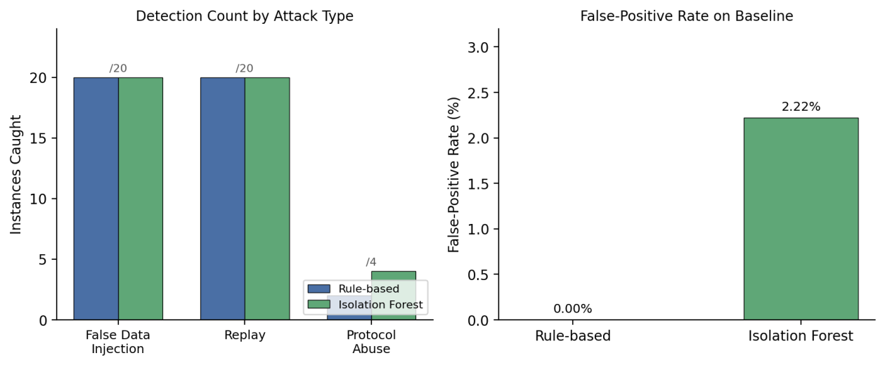
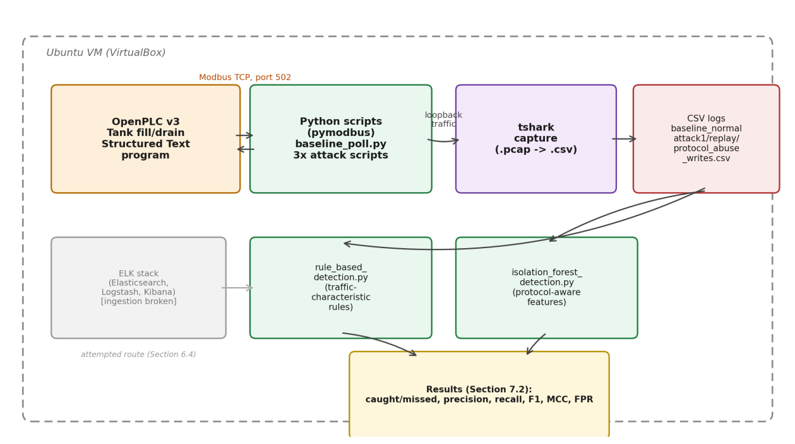
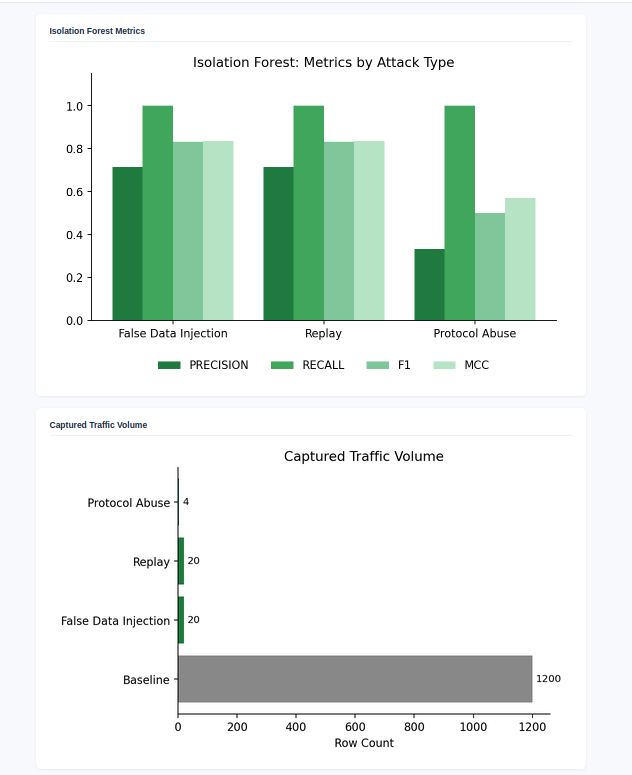

# Rule-Based vs Machine Learning Detection for Modbus OT Traffic

**MSc Cybersecurity dissertation, Cardiff University (2026)**
*Evaluating Machine Learning Approaches for Anomaly Detection in OT Network Traffic*

Most industrial (OT) sites still detect attacks with rule-based, SIEM-style alerting. It only catches what someone wrote a rule for. This project builds a Modbus TCP testbed from scratch, attacks it three ways, and compares a rule-based detector directly against an unsupervised **Isolation Forest** model that uses **protocol-aware features**.

Most published work compares ML models against each other. This project compares ML against the rule-based detection teams already run in practice, on identical traffic.

## Headline result

| Attack | Rule-based | Isolation Forest |
|---|---|---|
| False data injection | 20 / 20 | 20 / 20 |
| Replay | 20 / 20 | 20 / 20 |
| Protocol abuse | **2 / 4** | **4 / 4** |
| False-positive rate (baseline) | **0.00%** | **2.22%** |

The Isolation Forest closed a real detection gap. The rule-based protocol rule only looked at *writes*, so two illegal *read* requests got straight through. The ML model caught them without anyone writing a rule for them. The cost was a 2.22% false-positive rate on normal traffic, and the project measures that trade-off instead of assuming one approach wins.



## Testbed



| Component | Details |
|---|---|
| PLC | OpenPLC v3, tank fill/drain process written in Structured Text |
| Environment | Ubuntu VM in VirtualBox |
| Protocol | Modbus TCP, port 502 |
| Traffic generation | Python + pymodbus |
| Capture | tshark on loopback, exported from pcap to CSV |
| Detection | pandas (rule-based), scikit-learn (Isolation Forest) |
| Reporting | Self-contained HTML dashboard |

## Attacks

| Attack | Script | What it does |
|---|---|---|
| False data injection | `false_data_injection.py` | Writes an implausible value (900) to the tank holding register, 10 times at a steady 5 s interval so timing alone can't give it away |
| Replay | `replay_attack.py` | Re-sends a legitimate write captured from normal traffic. Modbus has no nonces or timestamps, so nothing marks it as old |
| Protocol abuse | `protocol_abuse_attack.py` | Illegal read at register 9999, coil write to unmapped address 500, oversized write beyond the 123-register limit |

A 1,200-row baseline of normal polling traffic (`baseline_poll.py`) was captured **before** any attack ran, so training and false-positive data were never contaminated.

## The two detectors

**Rule-based** (`detection/rule_based_detection.py`): three rules using only fields a real monitoring tool would see:
- **FDI rule:** register writes with values outside the normal 200 to 800 process range
- **Replay rule:** the same (register, value) write repeated within 30 seconds
- **Protocol rule:** Modbus exception codes, or writes to registers/coils outside the known map

**Isolation Forest** (`detection/isolation_forest_detection.py`): trained only on normal traffic, so no attack data and no labels. Six protocol-aware features, each computed **per register** so a register is only compared with its own history:

| Feature | Why it's there |
|---|---|
| `function_code`, `register_address` | Tie every request to what this controller actually exposes |
| `register_value` | The raw value written or read |
| `value_delta` | A real tank level moves gradually; an injected value jumps |
| `inter_arrival_same_reg` | Replay breaks a register's normal polling rhythm |
| `is_write` | An illegal read and an illegal write mean different things |

The baseline is split 70/30. The 30% holdout sets the anomaly threshold and measures the false-positive rate on traffic the model never saw. Contamination was tuned over 0.01, 0.02, 0.05 and 0.10; **0.02** gave 100% mean recall at 2.22% FPR.

| Attack | Precision | Recall | F1 | MCC |
|---|---|---|---|---|
| False data injection | 0.714 | 1.000 | 0.833 | 0.836 |
| Replay | 0.714 | 1.000 | 0.833 | 0.836 |
| Protocol abuse | 0.333 | 1.000 | 0.500 | 0.571 |

The lower precision on protocol abuse comes from class imbalance (only 4 samples at the same FPR). It doesn't mean the model is weaker on that attack.



## Findings worth knowing about

1. **Detection is not attribution.** False data injection and replay were near-identical at the traffic level. Both the FDI rule *and* the replay rule fired on both attacks. Any traffic-only detector can say "something is wrong" but needs extra context (like a known write schedule) to say *what*.
2. **The PLC accepted an illegal write.** OpenPLC accepted a coil write to address 500, which isn't mapped to anything. Controller-side validation can't be assumed, which is a good argument for network-level detection.
3. **tshark reports the request's function code on exception responses**, not the exception-flagged value (`0x80 + code`). Any Modbus detection built on `modbus.func_code` can't treat "exception response" as a standalone signal.
4. **Some protocol abuse never reaches the wire.** pymodbus refused the oversized write client-side, so there was no packet to detect. That case is recorded as N/A, not as a detection.

## Repository layout

```
attacks/      baseline_poll.py, false_data_injection.py, replay_attack.py, protocol_abuse_attack.py
detection/    rule_based_detection.py, isolation_forest_detection.py
dashboard/    build_dashboard.py  (single-file HTML, no server needed)
elk/          docker-compose.yml, logstash.conf  (original ELK route, see below)
data/         captured CSVs (see data/README.md for format and capture steps)
results/      generated detection results and dashboard
docs/images/  figures
```

## Running it

```bash
pip install -r requirements.txt

python3 detection/rule_based_detection.py         # -> results/rule_based_results.csv
python3 detection/isolation_forest_detection.py   # -> results/ml_results.csv
python3 dashboard/build_dashboard.py              # -> results/dashboard.html
```

The detection scripts read the CSVs in `data/`. To generate fresh traffic you need a running OpenPLC instance and tshark; see `data/README.md`.

> ⚠️ The attack scripts are for an isolated lab only. Never point them at a real PLC or any system you don't own.

## What didn't go to plan

The original design sent all traffic through an **ELK stack**, with rule-based detection running as Kibana queries. Elasticsearch and Kibana ran fine, but Logstash ingestion never became reliable. Problems included a `/dev/null` sincedb causing duplicate ingestion, sincedb then marking files as already read after an index reset, a hardcoded `attack_type` field, and Elastic Common Schema field-path changes. Both detectors were moved to read the exported CSVs directly. The detection logic and the comparison are unaffected; only the live Kibana view was lost. The ELK configs are kept in `elk/` for reference.

## Limitations

- One simulated process, one protocol (Modbus TCP), and OpenPLC rather than a commercial PLC
- Only 4 protocol-abuse samples, so that row's precision should be read with care
- Single run with one random seed; no confidence intervals
- No comparison against a protocol-*agnostic* ML model, so the "protocol-aware features help" claim is supported against rules, not against other ML feature sets

## Next steps

- More protocol-abuse samples (about 20, to match the other attacks)
- Repeat runs across several random seeds and report the variance
- A protocol-agnostic Isolation Forest on the same traffic, for a direct feature-set comparison
- Another process or protocol (e.g. DNP3)
- Fix Logstash ingestion and run detection live

## Background

I worked on this after a six-month OT security placement at an industrial manufacturer, where I used Darktrace, Nozomi and Tenable across live plant networks. That experience is where the question came from: what does rule-based monitoring actually miss?

## Author

**Dewanshi Agarkar**, MSc Cybersecurity, Cardiff University
[LinkedIn](https://www.linkedin.com/in/YOUR-PROFILE)
